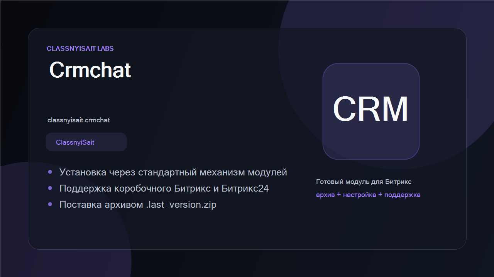
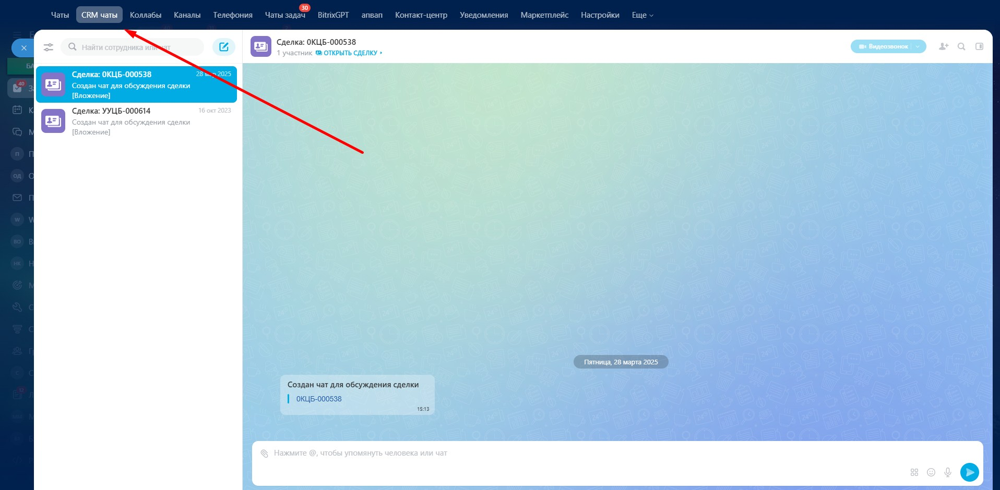

# CRM Chats for Bitrix24

[Русская версия](README.ru.md) · [MIT License](LICENSE)

[](https://github.com/ClassnyiSait-Labs/bitrix24-crm-chat/actions/workflows/ci.yml) [](https://github.com/ClassnyiSait-Labs/bitrix24-crm-chat/releases/latest) [](https://www.php.net/) [](LICENSE)


Free and open-source module for **self-hosted Bitrix24** that adds a dedicated **"CRM chats"** tab
to the messenger, so deal and contact conversations are one click away instead of buried in the
general Recent list.



## Why

In a sales-heavy portal, CRM-linked chats and internal team chats end up in the same flat list.
Sales people scroll past team noise to find the client thread. This module separates the two:
CRM conversations get their own tab in the messenger navigation.

## Features

- Dedicated "CRM chats" tab in the messenger navigation.
- Filtering of chats by CRM entity type.
- Keeps the standard messenger behaviour intact — nothing is replaced, only added.
- Works with the self-hosted Bitrix24 messenger (v26 UI).

## Requirements

- Self-hosted Bitrix24, version 26.0 or newer
- Web version of the messenger

## Installation

1. Copy the `classnyisait.crmchat` folder into `/local/modules/` (or `/bitrix/modules/`).
2. **Marketplace → Installed solutions** → *CRM chats* → *Install*.
3. Reload the messenger — the "CRM chats" tab appears in the navigation.

Marketplace listing: <https://marketplace.1c-bitrix.ru/solutions/classnyisait.crmchat/>

## Screenshots



## Project layout

```
classnyisait.crmchat/
├── install/js/         messenger navigation integration and CRM chat filter
├── lib/CrmChat.php     CRM chat selection logic
├── lib/EventHandler.php, lib/EventRegistrar.php  event wiring
└── test/               PHP tests
```

## Development

```bash
composer install
composer test          # 28 PHPUnit tests
```

Tests cover the pure logic that runs without a Bitrix kernel. Anything touching the
database, the basket or the messenger UI needs a live portal and is verified manually —
see [CONTRIBUTING.md](CONTRIBUTING.md).

CI runs the linter and the test suite on PHP 8.1, 8.2 and 8.3 for every push and pull request.

## Contributing

Issues and pull requests are welcome. Please state your Bitrix24 build number when reporting a
problem with the messenger UI.

## License

MIT — see [LICENSE](LICENSE).

Developed by [ClassnyiSait Labs](https://classnyisait.ru/) ·
[Support the developer](https://classnyisait.ru/support)
